# DER — LotaMenos (Oracle FIAP)

Modelo físico das tabelas `T_LM_*` criadas por `database/01_ddl.sql`. As chaves primárias são `NUMBER GENERATED BY DEFAULT AS IDENTITY`.

```mermaid
erDiagram
    T_LM_LINHA ||--o{ T_LM_LINHA_ESTACAO : "possui"
    T_LM_ESTACAO ||--o{ T_LM_LINHA_ESTACAO : "pertence"
    T_LM_ESTACAO ||--o{ T_LM_HISTORICO_LOTACAO : "tem histórico"
    T_LM_LINHA ||--o{ T_LM_HISTORICO_LOTACAO : "tem histórico"
    T_LM_USUARIO ||--o{ T_LM_RELATO_LOTACAO : "relata"
    T_LM_ESTACAO ||--o{ T_LM_RELATO_LOTACAO : "recebe relato"
    T_LM_LINHA ||--o{ T_LM_RELATO_LOTACAO : "recebe relato"
    T_LM_USUARIO ||--o{ T_LM_CONSULTA_VIAGEM : "consulta"
    T_LM_ESTACAO ||--o{ T_LM_CONSULTA_VIAGEM : "origem"
    T_LM_ESTACAO ||--o{ T_LM_CONSULTA_VIAGEM : "destino"
    T_LM_ESTACAO |o--o{ T_LM_CONSULTA_VIAGEM : "estação crítica"

    T_LM_LINHA {
        NUMBER ID_LINHA PK
        NUMBER NR_LINHA UK "1..99"
        VARCHAR2 NM_LINHA "40"
        VARCHAR2 DS_COR "#RRGGBB"
        VARCHAR2 DS_OPERADORA "METRO | CPTM"
    }
    T_LM_ESTACAO {
        NUMBER ID_ESTACAO PK
        VARCHAR2 NM_ESTACAO UK "60"
        NUMBER ST_INTEGRACAO "0 | 1"
        NUMBER ST_ATIVA "0 | 1"
    }
    T_LM_LINHA_ESTACAO {
        NUMBER ID_LINHA_ESTACAO PK
        NUMBER ID_LINHA FK "UK(ID_LINHA, ID_ESTACAO)"
        NUMBER ID_ESTACAO FK
        NUMBER NR_ORDEM "UK(ID_LINHA, NR_ORDEM)"
    }
    T_LM_HISTORICO_LOTACAO {
        NUMBER ID_HISTORICO PK
        NUMBER ID_ESTACAO FK
        NUMBER ID_LINHA FK
        VARCHAR2 DS_SENTIDO "SENTIDO_BARRA_FUNDA | SENTIDO_ITAQUERA"
        VARCHAR2 DS_TIPO_DIA "UTIL | SABADO | DOMINGO"
        VARCHAR2 HR_FAIXA "HH:mm (15 em 15 min)"
        NUMBER NR_INDICE "0..100"
    }
    T_LM_USUARIO {
        NUMBER ID_USUARIO PK
        VARCHAR2 NM_USUARIO "100"
        VARCHAR2 DS_EMAIL UK "120"
        VARCHAR2 DS_PERFIL "TRABALHADOR | IDOSO | MOBILIDADE_REDUZIDA | ESTUDANTE"
        NUMBER VL_REPUTACAO "NUMBER(3,2) 0.3..1.5"
        TIMESTAMP DT_CADASTRO
    }
    T_LM_RELATO_LOTACAO {
        NUMBER ID_RELATO PK
        NUMBER ID_USUARIO FK
        NUMBER ID_ESTACAO FK
        NUMBER ID_LINHA FK
        VARCHAR2 DS_SENTIDO
        VARCHAR2 DS_NIVEL "VAZIO | MODERADO | CHEIO | LOTADO"
        TIMESTAMP DT_RELATO
    }
    T_LM_CONSULTA_VIAGEM {
        NUMBER ID_CONSULTA PK
        NUMBER ID_USUARIO FK
        NUMBER ID_ESTACAO_ORIGEM FK
        NUMBER ID_ESTACAO_DESTINO FK
        VARCHAR2 DS_SENTIDO
        DATE DT_VIAGEM
        VARCHAR2 HR_DESEJADO "HH:mm"
        VARCHAR2 HR_SUGERIDO "HH:mm"
        NUMBER NR_INDICE_DESEJADO "0..100"
        NUMBER NR_INDICE_SUGERIDO "0..100"
        NUMBER ID_ESTACAO_CRITICA FK "nulo"
        NUMBER ST_SUGESTAO_ACEITA "0 | 1 | nulo"
        TIMESTAMP DT_CONSULTA
    }
```

## Constraints

| Tabela | PK | FKs | UNIQUE | CHECK |
|---|---|---|---|---|
| T_LM_LINHA | PK_LM_LINHA | — | UK_LM_LINHA_NUMERO | CK_LM_LINHA_OPERADORA, CK_LM_LINHA_COR, CK_LM_LINHA_NUMERO |
| T_LM_ESTACAO | PK_LM_ESTACAO | — | UK_LM_ESTACAO_NOME | CK_LM_EST_INTEGRACAO, CK_LM_EST_ATIVA |
| T_LM_LINHA_ESTACAO | PK_LM_LINHA_ESTACAO | FK_LM_LE_LINHA, FK_LM_LE_ESTACAO | UK_LM_LE_LINHA_ESTACAO, UK_LM_LE_LINHA_ORDEM | CK_LM_LE_ORDEM |
| T_LM_HISTORICO_LOTACAO | PK_LM_HISTORICO | FK_LM_HIST_ESTACAO, FK_LM_HIST_LINHA | UK_LM_HIST_CHAVE | CK_LM_HIST_SENTIDO, CK_LM_HIST_TIPO_DIA, CK_LM_HIST_FAIXA, CK_LM_HIST_INDICE |
| T_LM_USUARIO | PK_LM_USUARIO | — | UK_LM_USUARIO_EMAIL | CK_LM_USU_PERFIL, CK_LM_USU_REPUTACAO |
| T_LM_RELATO_LOTACAO | PK_LM_RELATO | FK_LM_REL_USUARIO, FK_LM_REL_ESTACAO, FK_LM_REL_LINHA | — | CK_LM_REL_SENTIDO, CK_LM_REL_NIVEL |
| T_LM_CONSULTA_VIAGEM | PK_LM_CONSULTA | FK_LM_CON_USUARIO, FK_LM_CON_ORIGEM, FK_LM_CON_DESTINO, FK_LM_CON_CRITICA | — | CK_LM_CON_SENTIDO, CK_LM_CON_IND_DES, CK_LM_CON_IND_SUG, CK_LM_CON_ACEITA, CK_LM_CON_ORIG_DEST |

## Mapeamento entidade ↔ tabela

| Entidade Java (`model`) | Tabela |
|---|---|
| `Linha` | `T_LM_LINHA` |
| `Estacao` | `T_LM_ESTACAO` |
| `LinhaEstacao` | `T_LM_LINHA_ESTACAO` |
| `HistoricoLotacao` | `T_LM_HISTORICO_LOTACAO` |
| `Usuario` | `T_LM_USUARIO` |
| `RelatoLotacao` | `T_LM_RELATO_LOTACAO` |
| `ConsultaViagem` | `T_LM_CONSULTA_VIAGEM` |

Os enums (`Operadora`, `Sentido`, `TipoDia`, `PerfilUsuario`, `NivelLotacao`) são gravados como texto (`@Enumerated(EnumType.STRING)` → `VARCHAR2` com `CHECK IN (...)`). Os booleanos ficam em `NUMBER(1)`.
