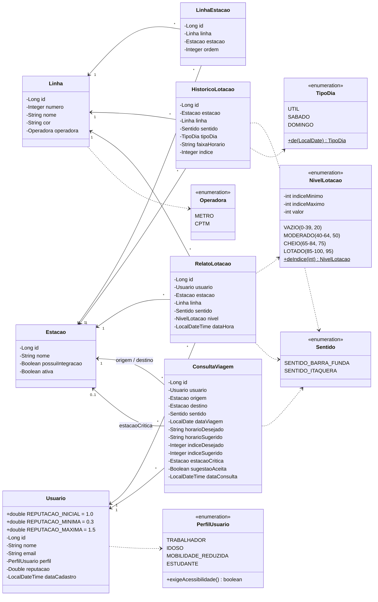
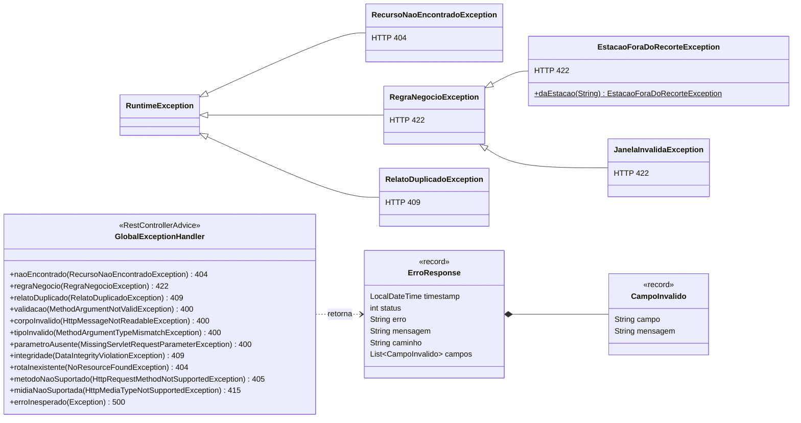
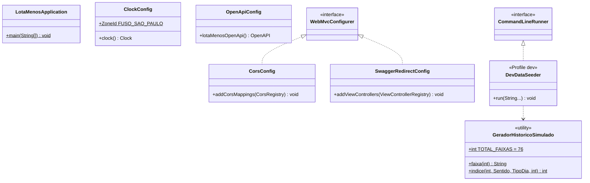

# Diagrama de Classes — LotaMenos API

Gerado a partir do código final (`src/main/java/br/com/fiap/lotamenos`). Para virar imagem, cole o bloco em <https://mermaid.live>. O GitHub também renderiza Mermaid automaticamente.

## 1. Camada model (entidades e enums)

## 2. Camadas controller → bo → dao

```mermaid
classDiagram
    direction TB

    class LinhaController {
        +listar() List~LinhaResponse~
        +buscar(Long) LinhaResponse
        +listarEstacoes(Long) List~EstacaoNaLinhaResponse~
        +criar(LinhaRequest) ResponseEntity
        +atualizar(Long, LinhaRequest) LinhaResponse
        +excluir(Long) ResponseEntity
    }
    class EstacaoController {
        +listar() List~EstacaoResponse~
        +buscar(Long) EstacaoResponse
        +lotacaoAtual(Long, Sentido) LotacaoAtualResponse
        +criar(EstacaoRequest) ResponseEntity
        +atualizar(Long, EstacaoRequest) EstacaoResponse
        +excluir(Long) ResponseEntity
    }
    class UsuarioController {
        +listar() List~UsuarioResponse~
        +buscar(Long) UsuarioResponse
        +criar(UsuarioRequest) ResponseEntity
        +atualizar(Long, UsuarioRequest) UsuarioResponse
        +excluir(Long) ResponseEntity
    }
    class RelatoLotacaoController {
        +listar(Long, Integer) List~RelatoResponse~
        +buscar(Long) RelatoResponse
        +registrar(RelatoRequest) ResponseEntity
        +atualizar(Long, RelatoUpdateRequest) RelatoResponse
        +excluir(Long) ResponseEntity
    }
    class HistoricoLotacaoController {
        +listar(Long, Sentido, TipoDia) List~HistoricoResponse~
        +buscar(Long) HistoricoResponse
        +criar(HistoricoRequest) ResponseEntity
        +atualizar(Long, HistoricoRequest) HistoricoResponse
        +excluir(Long) ResponseEntity
    }
    class ViagemController {
        +planejar(PlanejarViagemRequest) ResponseEntity
        +listar() List~ViagemResponse~
        +buscar(Long) ViagemResponse
        +registrarAceite(Long, AceiteRequest) ViagemResponse
        +excluir(Long) ResponseEntity
    }
    class ImpactoController {
        +calcular() ImpactoResponse
    }

    class LinhaBO {
        +int NUMERO_LINHA_RECORTE = 3
        +listar() List~LinhaResponse~
        +buscar(Long) LinhaResponse
        +listarEstacoes(Long) List~EstacaoNaLinhaResponse~
        +criar(LinhaRequest) LinhaResponse
        +atualizar(Long, LinhaRequest) LinhaResponse
        +excluir(Long) void
    }
    class EstacaoBO {
        +listar() List~EstacaoResponse~
        +buscar(Long) EstacaoResponse
        +criar(EstacaoRequest) EstacaoResponse
        +atualizar(Long, EstacaoRequest) EstacaoResponse
        +excluir(Long) void
        +lotacaoAtual(Long, Sentido) LotacaoAtualResponse
    }
    class UsuarioBO {
        +listar() List~UsuarioResponse~
        +buscar(Long) UsuarioResponse
        +criar(UsuarioRequest) UsuarioResponse
        +atualizar(Long, UsuarioRequest) UsuarioResponse
        +excluir(Long) void
    }
    class RelatoLotacaoBO {
        +int INTERVALO_ANTISPAM_MINUTOS = 10
        +int TOLERANCIA_COERENCIA = 20
        +listar(Long, Integer) List~RelatoResponse~
        +buscar(Long) RelatoResponse
        +registrar(RelatoRequest) RelatoResponse
        +atualizar(Long, RelatoUpdateRequest) RelatoResponse
        +excluir(Long) void
        ~novaReputacao(double, int, int) double$
    }
    class HistoricoLotacaoBO {
        +listar(Long, Sentido, TipoDia) List~HistoricoResponse~
        +buscar(Long) HistoricoResponse
        +criar(HistoricoRequest) HistoricoResponse
        +atualizar(Long, HistoricoRequest) HistoricoResponse
        +excluir(Long) void
    }
    class LotacaoBO {
        +int INDICE_SEM_HISTORICO = 30
        +int JANELA_RELATOS_MINUTOS = 30
        +calcularIndice(Estacao, Linha, Sentido, LocalDateTime) int
        +calcularDetalhado(Estacao, Linha, Sentido, LocalDateTime) ResultadoIndice
        +carregarMapa(Linha, Sentido, LocalDate) MapaLotacao
        +combinar(int, List~RelatoLotacao~, LocalDateTime) ResultadoIndice$
        ~consideraRelatos(LocalDateTime, LocalDateTime) boolean$
    }
    class ViagemBO {
        +int DURACAO_MAXIMA_JANELA_MINUTOS = 180
        +planejar(PlanejarViagemRequest) ViagemResponse
        +listar() List~ViagemResponse~
        +buscar(Long) ViagemResponse
        +registrarAceite(Long, AceiteRequest) ViagemResponse
        +excluir(Long) void
        ~definirSentido(int, int) Sentido$
        ~validarJanela(LocalTime, LocalTime, LocalTime) void$
        ~gerarHorariosCandidatos(LocalTime, LocalTime, LocalTime) List~LocalTime~$
        ~avaliar(LocalTime, List~Estacao~, MapaLotacao) AvaliacaoHorario$
        ~escolherMelhor(List~AvaliacaoHorario~, LocalTime) AvaliacaoHorario$
        ~montarDica(String, String, String, boolean) String$
    }
    class ImpactoBO {
        +int DIAS_USUARIO_ATIVO = 30
        +calcular() ImpactoResponse
    }
    class MapaLotacao {
        -LocalDate data
        -Map historicoPorEstacao
        -Map relatosPorEstacao
        -LocalDateTime agora
        +indice(Long, LocalTime) int
    }
    class ResultadoIndice {
        <<record>>
        int indice
        int base
        int relatosConsiderados
        double pesoRelatos
    }
    class AvaliacaoHorario {
        <<record>>
        LocalTime horario
        int indice
        Estacao estacaoCritica
    }
    class HorarioUtil {
        <<utility>>
        +parse(String) LocalTime$
        +formatar(LocalTime) String$
        +faixaDe(LocalTime) String$
        +minutosDoDia(LocalTime) int$
        +deMinutos(int) LocalTime$
    }

    class JpaRepository~T, Long~ {
        <<interface>>
        +findById(Long) Optional~T~
        +findAll() List~T~
        +save(T) T
        +delete(T) void
        +count() long
        +flush() void
    }
    class LinhaDAO {
        <<interface>>
        +findByNumero(Integer) Optional~Linha~
        +existsByNumero(Integer) boolean
        +existsByNumeroAndIdNot(Integer, Long) boolean
        +findAllByOrderByNumeroAsc() List~Linha~
    }
    class EstacaoDAO {
        <<interface>>
        +findByNomeIgnoreCase(String) Optional~Estacao~
        +existsByNomeIgnoreCase(String) boolean
        +existsByNomeIgnoreCaseAndIdNot(String, Long) boolean
        +findAllByOrderByNomeAsc() List~Estacao~
    }
    class LinhaEstacaoDAO {
        <<interface>>
        +listarPorLinhaEmOrdem(Long) List~LinhaEstacao~
        +findByLinhaIdAndEstacaoId(Long, Long) Optional~LinhaEstacao~
        +existsByLinhaIdAndEstacaoId(Long, Long) boolean
    }
    class HistoricoLotacaoDAO {
        <<interface>>
        +findByEstacaoIdAndLinhaIdAndSentidoAndTipoDiaAndFaixaHorario(...) Optional~HistoricoLotacao~
        +existsByEstacaoIdAndLinhaIdAndSentidoAndTipoDiaAndFaixaHorario(...) boolean
        +findByLinhaIdAndSentidoAndTipoDia(Long, Sentido, TipoDia) List~HistoricoLotacao~
        +filtrar(Long, Sentido, TipoDia) List~HistoricoLotacao~
    }
    class UsuarioDAO {
        <<interface>>
        +existsByEmailIgnoreCase(String) boolean
        +existsByEmailIgnoreCaseAndIdNot(String, Long) boolean
        +findAllByOrderByIdAsc() List~Usuario~
    }
    class RelatoLotacaoDAO {
        <<interface>>
        +buscarRecentes(Long, Long, Sentido, LocalDateTime, LocalDateTime) List~RelatoLotacao~
        +buscarRecentesDaLinha(Long, Sentido, LocalDateTime, LocalDateTime) List~RelatoLotacao~
        +existeRelatoNoIntervalo(Long, Long, LocalDateTime, LocalDateTime) boolean
        +filtrar(Long, LocalDateTime) List~RelatoLotacao~
        +usuariosComRelatoDesde(LocalDateTime) List~Long~
    }
    class ConsultaViagemDAO {
        <<interface>>
        +listarTodas() List~ConsultaViagem~
        +countBySugestaoAceitaTrue() long
        +mediaReducaoNasAceitas() Double
        +usuariosComConsultaDesde(LocalDateTime) List~Long~
    }

    LinhaController --> LinhaBO
    EstacaoController --> EstacaoBO
    UsuarioController --> UsuarioBO
    RelatoLotacaoController --> RelatoLotacaoBO
    HistoricoLotacaoController --> HistoricoLotacaoBO
    ViagemController --> ViagemBO
    ImpactoController --> ImpactoBO

    LinhaBO --> LinhaDAO
    LinhaBO --> LinhaEstacaoDAO
    EstacaoBO --> EstacaoDAO
    EstacaoBO --> LinhaDAO
    EstacaoBO --> LinhaEstacaoDAO
    EstacaoBO --> LotacaoBO
    UsuarioBO --> UsuarioDAO
    HistoricoLotacaoBO --> HistoricoLotacaoDAO
    HistoricoLotacaoBO --> EstacaoDAO
    HistoricoLotacaoBO --> LinhaDAO
    HistoricoLotacaoBO --> LinhaEstacaoDAO
    RelatoLotacaoBO --> RelatoLotacaoDAO
    RelatoLotacaoBO --> UsuarioDAO
    RelatoLotacaoBO --> EstacaoDAO
    RelatoLotacaoBO --> LinhaDAO
    RelatoLotacaoBO --> LinhaEstacaoDAO
    RelatoLotacaoBO --> LotacaoBO
    LotacaoBO --> HistoricoLotacaoDAO
    LotacaoBO --> RelatoLotacaoDAO
    LotacaoBO ..> MapaLotacao : cria
    LotacaoBO ..> ResultadoIndice : retorna
    ViagemBO --> ConsultaViagemDAO
    ViagemBO --> UsuarioDAO
    ViagemBO --> EstacaoDAO
    ViagemBO --> LinhaDAO
    ViagemBO --> LinhaEstacaoDAO
    ViagemBO --> LotacaoBO
    ViagemBO ..> AvaliacaoHorario
    ViagemBO ..> MapaLotacao
    ImpactoBO --> ConsultaViagemDAO
    ImpactoBO --> RelatoLotacaoDAO

    JpaRepository <|-- LinhaDAO
    JpaRepository <|-- EstacaoDAO
    JpaRepository <|-- LinhaEstacaoDAO
    JpaRepository <|-- HistoricoLotacaoDAO
    JpaRepository <|-- UsuarioDAO
    JpaRepository <|-- RelatoLotacaoDAO
    JpaRepository <|-- ConsultaViagemDAO
```

## 3. Camada exception

## 4. Camada config

> Os DTOs (pacote `dto`) são records de entrada e saída: `LinhaRequest/Response`, `EstacaoRequest/Response`, `EstacaoNaLinhaResponse`, `LotacaoAtualResponse`, `UsuarioRequest/Response`, `RelatoRequest`, `RelatoUpdateRequest`, `RelatoResponse`, `HistoricoRequest/Response`, `PlanejarViagemRequest`, `AceiteRequest`, `ViagemResponse` e `ImpactoResponse`. Os controllers recebem e devolvem apenas DTOs; as entidades nunca são expostas.
